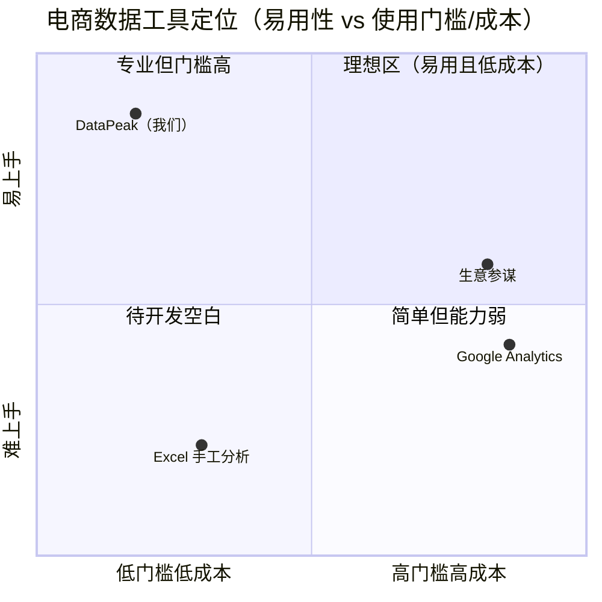
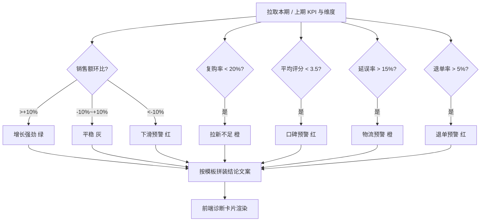

# 电商销售数据洞察看板 DataPeak · 增量产品需求文档（v2）

> **文档版本**：v2.0（增量重构）　**产品负责人**：许清楚（Xu）　**日期**：2026-10-05
> **适用范围**：在 v1「6 页面 + 8 接口 + Mock 数据」基础上，完成「接入真实 Olist 数据库 → 补齐卖家视角洞察 → 品牌与 UI/UX 升级」三层增量。
> **接手人**：架构师（负责增量架构设计 + 任务分解）；下游：前端 / 后端 / 测试 / 运维。
> **产品定位**：按"可发行上市"标准打磨，对外故事为——"我们按公司角色分工、以解决中小卖家真实痛点为目标做的产品"。

---

## 0. v1 → v2 改了什么（修订说明）

| 维度 | v1（现状） | v2（本次增量目标） |
|------|-----------|-------------------|
| 数据 | 硬编码 Mock（`MockOrderServiceImpl`） | 真实 Olist 库（~10 万订单，JPA 查询） |
| 视角 | 数据集展示视角 | 中小卖家"经营决策"视角 |
| 结论 | 只有数字，用户自己看 | 规则引擎自动出"人话结论 + 信号标签" |
| 语言 | 大量术语（客单价/环比/复购率） | 术语配"人话"解释气泡 |
| 品牌 | 无门面，像作业 | DataPeak 品牌 + 欢迎页 + 配色规范 |

---

## 1. 目标用户画像（中小电商卖家 / 运营）

> 核心共性痛点：**"数据太多不会分析"**——看不懂 Excel、不知道哪个品类该补货/该打折、不知道生意健康度如何。

### 画像 1：个体女装店主 · 林姐（35 岁）
- **背景**：3 人小团队，自管选品 + 客服，用 Excel 记流水，不会写公式 / 透视表。
- **诉求**：不知道哪类衣服好卖、该不该补货、生意是变好还是变差。
- **一天场景**：早 9 点开电脑 → 翻昨天订单 Excel → 凭感觉决定今天主推哪款 → 下午回顾客消息 → 晚上纠结要不要参加平台大促。

### 画像 2：代运营新人 · 小吴（23 岁）
- **背景**：代运营公司新人，管 5 个店铺，每天盯后台但看不懂"客单价 / 复购率"。
- **诉求**：老板问"这周生意怎么样"要能一句话答出；需要知道该推哪个品类。
- **一天场景**：午间拉各店数据 → 截图发群 → 被追问"为什么跌了"答不上 → 想要一个能自动给结论的工具。

### 画像 3：区域经销商老板 · 陈总（45 岁）
- **背景**：代理多个品牌，线下 + 线上，有 ERP 但报表滞后一周。
- **诉求**：快速看生意健康度、哪个区域 / 品类出问题、需要预警。
- **一天场景**：晨会看昨日简报 → 问团队"哪出了问题" → 需要预警与诊断支撑决策。

---

## 2. 核心痛点 → 功能映射表

| # | 用户痛点 | 现有功能 | 状态 | 增量动作 | 优先级 |
|---|---------|---------|------|---------|--------|
| 1 | 看不懂 Excel / 数据 | F4–F7 图表可展示 | 已满足（展示） | 卖家语言改造：术语配"人话"解释气泡 | P0 |
| 2 | 不知道生意是好是坏 | 无 | 缺失 | **经营健康度诊断**（规则引擎自动出结论） | P0 |
| 3 | 数据不真实 / 不信任 | Mock 硬编码 | 红线 | 接入真实 Olist 库（JPA + 导入脚本） | P0 |
| 4 | 不知道该补货 / 打折什么 | F5 品类排行 / F6 TOP10（无建议） | 需改造 | **补货 / 促销建议信号** | P1 |
| 5 | 不知道哪出问题（异常） | 无 | 缺失 | **异常预警**（品类骤降 / 评分骤降 / 延误） | P1 |
| 6 | 没品牌感、像作业 | 无门面 | 缺失 | **欢迎页 / 登录门面 + 品牌** | P1 |
| 7 | 图表杂乱不好看 | 已有但不统一 | 需改造 | **图表配色规范 + ECharts 主题** | P1 |
| 8 | 多视角 / 多角色 | 无 | 缺失 | 卖家视角切换（seller 维度切片） | P2 |

---

## 3. 差异化定位（竞品对比）

- **我们做什么**：轻量、开箱即用的"经营诊断 + 建议"，零学习成本，自动给结论，全卖家语言。
- **我们不做什么**：不接真实交易 / 订单处理系统（演示数据集）、不做实时营销投放、不做多店铺权限管理、不替代专业 BI（如 Tableau / 生意参谋）。
- **一句话价值**：生意参谋面向大商家、付费且复杂；DataPeak 面向"看不懂数据"的中小卖家，用**真实数据 + 自动结论**，5 分钟看懂生意。

---

## 4. 需求池（P0 / P1 / P2）

> **落地原则**：前端为**原生 JS、无 AI 后端**。P0 结论类需求一律用**规则引擎（阈值 + 环比计算）**在服务端拼装文案，前端只负责渲染，降低前端复杂度、保证可答辩讲解。

### P0（必须，本次增量核心）

**P0-1　真实数据接入（红线）**
- 后端将 `MockOrderServiceImpl` 改为基于 JPA 的真实查询；新增 Entity（Order / OrderItem / Product / Customer / Payment）+ Repository。
- 提供 CSV → MySQL 导入脚本（`LOAD DATA INFILE` 或 Python），把 `archive/` 下 Olist 约 10 万订单真实入库。
- 验收：看板数字与 Olist 一致、源码无硬编码数组、Swagger 可查真实数据。

**P0-2　经营健康度诊断（规则引擎）**
- 基于 KPI + 环比 + 复购率 + 评分 + 物流延误率 + 退单率，输出"自动化结论文字 + 信号标签"。
- **规则表（阈值，可在配置中调整）**：

| 指标 | 计算口径（基于现有表字段） | 健康线 / 阈值 | 信号 |
|------|--------------------------|--------------|------|
| 销售额环比 | 本期 vs 上期（月/所选周期） | > +10% / −10%~+10% / < −10% | 增长强劲(绿) / 平稳(灰) / 下滑预警(红) |
| 复购率 | 复购 unique 数 ÷ 总 unique 数 | < 20% | 拉新不足(橙) |
| 平均评分 | AVG(review_score) | < 3.5 / ≥ 4.2 | 口碑预警(红) / 口碑优秀(绿) |
| 物流延误率 | 实际送达 > 预计送达 的订单占比 | > 15% | 物流预警(橙) |
| 退单率 | status='canceled' ÷ 总订单 | > 5% | 退单预警(红) |

- **结论文案示例**（服务端模板拼装）：
  > "本期销售额 ¥X，环比 **+12%（增长强劲）**，主要由『bed_bath_table』品类带动（+34%）；但**复购率仅 18%** 低于健康线 20%，建议加强老客召回。"
- 数据可用性说明：以上维度均已在 `schema.sql` 与 Olist CSV 中具备（purchase_timestamp 算环比、customer_unique_id 算复购、review_score 算口碑、delivered vs estimated 算延误、order_status 算退单）。

**P0-3　卖家语言改造**
- 全局术语 → "人话"映射（解释气泡 / info 图标）：
  - 客单价 → "平均每个订单花了多少钱"
  - 复购率 → "老客户回头再买的比例"
  - 环比 → "和上一个周期比，涨了还是跌了"
  - TOP10 → "卖得最好的前 10 名"

**P0-4　诊断结论区 UI**
- 看板首页顶部新增"本期经营诊断"卡片：结论文字 + 信号标签（彩色 chip）。第一眼给结论。

### P1（应该，提升完成度 / 答辩亮点）

- **P1-1　补货 / 促销建议信号**：基于"品类销售增速 × 口碑 × 占比"输出 `重点投入 / 观察 / 促销去化` 标签。⚠️ Olist **无库存字段**，以"销售增速 × 口碑"作补货代理指标，并明确标注"基于销售趋势推测，非实时库存"。
- **P1-2　异常预警**：品类销售额环比骤降 > 30%、评分骤降 > 0.5、某支付方式占比突变 → 顶部预警条。
- **P1-3　品牌门面**：欢迎页 / 登录门面（DataPeak + Slogan），真实登录校验（用户表 + 密码 + Session/Token，轻量实现，不做 OAuth），侧边栏品牌区。
- **P1-4　图表配色规范 + ECharts 主题**：统一 6 页面主色 / 语义色 / 圆角 / 字体。
- **P1-5　卖家视角切换（真实多数据集）**：基于 `order_items.seller_id` → `sellers` 表，按卖家切片查看"我的店铺"数据；预设 3–5 个代表 seller 作为演示店铺（Olist 无"店铺"字段，以 seller_id 作店铺代理）。

### P2（可选，锦上添花）

- P2-1　诊断报告导出（图片 / PDF）
- P2-2　数据时间提示（"数据截至 2018-09，Olist 真实历史数据集"）
- P2-3　浅色 / 深色主题切换
- P2-4　移动端适配优化

### 给架构师：新增 / 改造接口清单

| 接口 | 方法 | 说明 | 类型 |
|------|------|------|------|
| `/api/diagnosis` | GET | 健康度诊断：KPI 信号 + 结论文案（服务端拼装） | **新增** |
| `/api/signals` | GET | 补货 / 促销建议信号 | **新增** |
| `/api/alerts` | GET | 异常预警列表 | **新增** |
| `/api/orders/kpi` `/trend` `/category-rank` `/product-ranking` 等 | GET | 从 Mock 改真实查询，并补充**环比 / 复购 / 评分 / 延误**字段 | 改造 |
| 说明 | — | 结论文案在服务端拼装，前端只渲染，契合原生 JS 无 AI 后端约束 | — |

### 经营诊断规则引擎流程（供架构参考）

---

## 5. UI / UX 升级方向

- **品牌**：产品名 **DataPeak**；Slogan 候选——
  ①「看不懂 Excel，也能看懂生意」②「让数据自己说话」③「中小卖家的生意仪表盘」。
  定为 **「看不懂 Excel 也能看懂生意」**（用户已确认，见第 6 节）。
- **欢迎页 / 门面**：首屏（独立 `welcome.html` 或 `index.html` 前置）→ 品牌名 + Slogan（"看不懂 Excel 也能看懂生意"）+ 三类用户一键进入 + "数据来源：Olist 巴西电商真实数据集（约 10 万订单）"增强可信度；登录为**真实校验**（用户表 + 密码 + Session/Token，轻量实现，不做 OAuth）。
- **图表配色规范**：
  - 主色 `#2F6BFF`（科技蓝）｜增长绿 `#22C55E`｜下滑红 `#EF4444`｜预警橙 `#F59E0B`｜中性灰 `#94A3B8`
  - 背景浅色 `#F7F9FC`｜卡片圆角 `12px`｜字体：系统无衬线
- **卖家语言改造**：全局术语映射 + 解释气泡 + 诊断卡片人话结论。
- **信息架构**：看板首页 = **诊断(置顶) + KPI + 趋势 + 品类 + TOP + 饼图 + 表格**，第一眼给结论。

---

## 6. 已拍板结论（用户确认，不再待确认）

> 以下 5 项原"待确认问题"已由用户 / 主理人拍板，作为增量开发的确定需求，不再变更。

1. **登录页**：**做真实登录校验**——新增用户表 + 密码 + Session/Token（轻量实现即可，不做 OAuth）。
2. **卖家视角切换**：**做真实多数据集切换**——基于 Olist 的 seller 维度（`order_items.seller_id` → `sellers` 表），支持按卖家切片查看"我的店铺"数据；预设 3–5 个代表 seller 作为演示店铺。⚠️ Olist 无"店铺"字段，以 `seller_id` 作为店铺代理，已诚实标注此映射。
3. **补货建议口径**：采用 **"销售增速 × 口碑评分"代理指标**，界面明确标注"推测口径，非真实库存"。
4. **品牌 Slogan**：定为 **"看不懂 Excel 也能看懂生意"**。
5. **时间口径**：改为 **"所选周期"**，并以数据集实际最大日期（Olist 约 2018-09）作为"当前"，避免答辩被问"为什么是 2018"。

---

## 7. 给架构师的交接说明

- 数据维度已齐备（时间 / 品类 / 价格 / 支付方式 / 评分 / 复购 / 延误 / 退单），无需新增 Olist 表。
- 结论类需求统一"服务端规则引擎拼装文案 + 前端渲染"，请据此设计 `diagnosis / signals / alerts` 接口返回结构（建议返回 `signals[]` + `conclusionText`）。
- 前端约束：原生 HTML/CSS/JS + ECharts，**禁止 Vue/React/axios**，接口用 `fetch`。
- 红线自查清单：真实数据库接入（非 Mock）、Git ≥ 10 次提交、AI 使用记录表、文档齐全。
