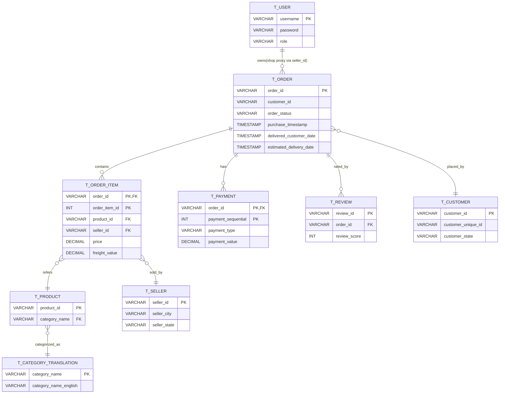
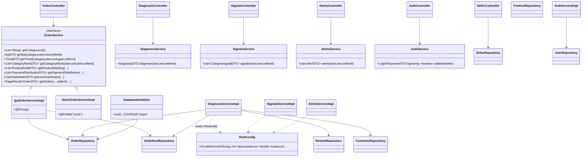
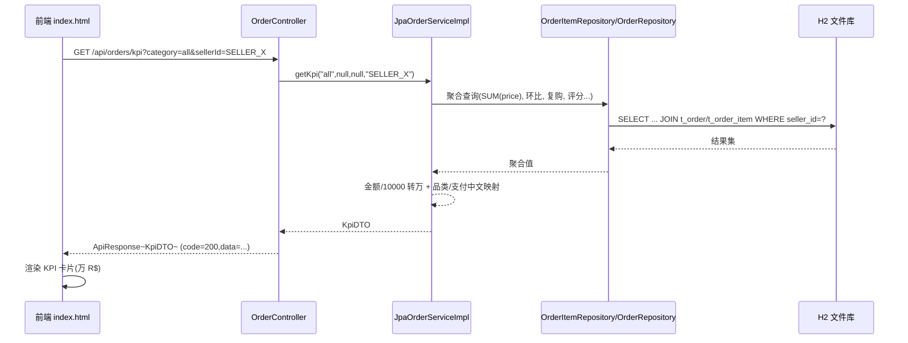
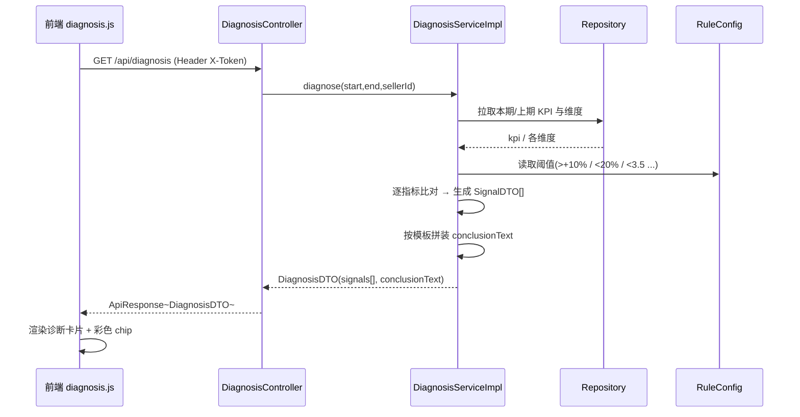
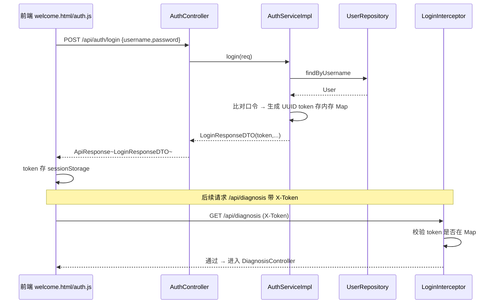
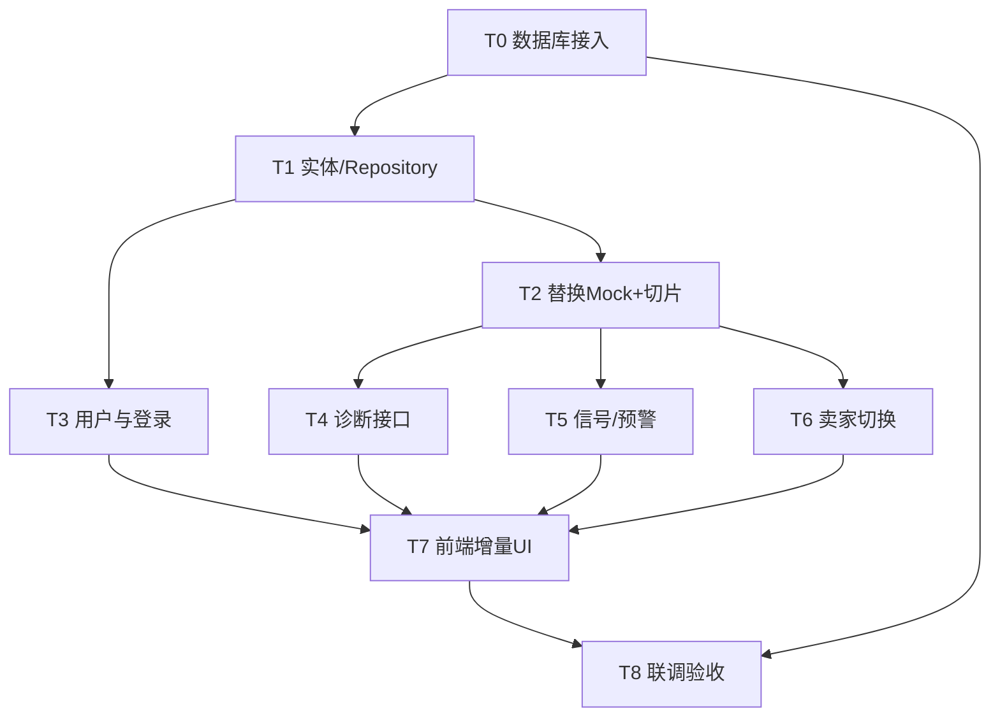

# DataPeak 电商数据看板 · 增量架构设计文档

> **文档版本**：v1.0（增量重构）　**架构师**：高见远（Gao）　**日期**：2026-10
> **依据**：`docs/增量PRD-v2.md`、`docs/角色分工文档.md`、`需求文档.md`、现有 `backend/`（Spring Boot 3.2 + JDK17 + JPA）、`dashboard/index.html`（原生 HTML/JS/ECharts）、`archive/` 下 9 个 Olist CSV。
> **目标**：在 v1「8 接口 + Mock」基础上，完成「真实数据库接入 → 卖家视角洞察 → 诊断/信号/预警 → 登录门面」三层增量，且**最小化改动现有 Controller/DTO**。

---

## 0. 设计结论速览（先给结论）

| 关键决策 | 结论 |
|---------|------|
| **数据库选型** | **默认 H2 文件库（file 模式）**，JPA 层与具体库解耦；保留 MySQL profile 供答辩切换（改 1 个配置文件即可）。理由见 §1。 |
| **CSV 导入** | **H2 `CSVREAD` 一次性批量导入**，由 `DatabaseInitializer` 在表为空时自举执行（~45 万行，秒级）。MySQL 备选 `LOAD DATA INFILE`（`import-mysql.sql`）。 |
| **Mock 替换** | 新增 `JpaOrderServiceImpl implements OrderService`（`@Primary`），原 `MockOrderServiceImpl` 加 `@Profile("mock")` 保留参考。**Controller / DTO / 接口路径 / 返回字段全部不变**。 |
| **新增接口** | `/api/diagnosis`、`/api/signals`、`/api/alerts`、`/api/auth/login`，统一走现有 `ApiResponse<T>`。 |
| **多卖家隔离** | 以 `order_items.seller_id` 作「店铺」代理（Olist 无店铺字段，设计里诚实标注），查询统一带可选 `sellerId` 参数切片。 |
| **登录** | 轻量真实校验：`t_user` 表 + `AuthController` + `LoginInterceptor`（仅保护 3 个新接口），**不引入 Spring Security 全家桶**。 |

---

## 1. 数据库接入方案（重点）

### 1.1 MySQL vs H2 —— 推荐结论与理由

**结论：推荐默认使用 H2 文件库（`jdbc:h2:file:./data/dashboard`）。**

课程原始需求文档明确写道：「数据须导入数据库（MySQL/H2 均可）」「后端从数据库查询，不可直接读取静态文件」。因此 **H2 完全满足「导入数据库」红线**，与 MySQL 在验收上等价。

| 维度 | H2 文件库（推荐） | MySQL 8.0 |
|------|----------------|-----------|
| 安装成本 | **零安装**，随应用自带驱动 | 需本机/ Docker 安装 MySQL 服务 |
| 演示稳定性 | **永不因数据库宕机失败**（文件即库） | 依赖外部服务，答辩现场风险高 |
| 满足「导入数据库」红线 | ✅ 数据真实落库、JPA 查询 | ✅ |
| 数据持久化 | ✅ 写入 `./data/dashboard.mv.db` 文件，可复现 | ✅ |
| 切换成本（若答辩要求 MySQL） | 改 `application.properties` 一个文件 + 切 profile | — |
| 批量导入（~45 万行） | `CSVREAD` 秒级 | `LOAD DATA INFILE` 秒级 |
| 「真实感」叙事 | 稍弱（可一句话说明：嵌入式文件库，满足验收） | 更强 |

**采用 H2 的三条核心理由**：① 课程环境「免安装」优先，H2 零运维；② 演示万无一失，不存在「库没起来」的翻车点；③ 验收等价（H2 同样是真实数据库，数据经 JPA 查询而非读 CSV）。

**可切换性（兜底）**：所有实体/Repository 用 JPA 标准注解，不绑定 H2 方言。如需 MySQL，仅需在 `application-mysql.properties` 中改 `spring.datasource.url/driver/dialect` 并 `spring.profiles.active=mysql` 即可，**代码零改动**。本设计同时提供 `database/import-mysql.sql`（LOAD DATA）。

> ⚠️ H2 保留字：`ORDER` 是 H2/MySQL 保留字，因此所有表名统一加 `t_` 前缀（`t_order`、`t_order_item` 等）。

### 1.2 Olist 9 表结构映射

| CSV 文件 | 行数 | 目标表 | 关键字段（进库） | 备注 |
|---------|------|-------|----------------|------|
| `olist_orders_dataset.csv` | 99,441 | `t_order` | order_id(PK), customer_id, order_status, order_purchase_timestamp, order_approved_at, order_delivered_carrier_date, order_delivered_customer_date, order_estimated_delivery_date | 主表；时间戳可空 |
| `olist_order_items_dataset.csv` | 112,650 | `t_order_item` | order_id+order_item_id(联合PK), product_id, **seller_id**, shipping_limit_date, price, freight_value | **seller_id 是店铺切片关键** |
| `olist_order_payments_dataset.csv` | 103,886 | `t_payment` | order_id+payment_sequential(联合PK), payment_type, payment_installments, payment_value | 支付方式 |
| `olist_order_reviews_dataset.csv` | 104,719 | `t_review` | review_id(PK), order_id, review_score, review_comment_title, review_comment_message, review_creation_date, review_answer_timestamp | 评分/口碑 |
| `olist_customers_dataset.csv` | 99,441 | `t_customer` | customer_id(PK), customer_unique_id, zip_code_prefix, customer_city, customer_state | 复购率（按 unique_id）、地区分布 |
| `olist_products_dataset.csv` | 32,951 | `t_product` | product_id(PK), category_name, name_length, description_length, photos_qty, weight_g, length_cm, height_cm, width_cm | **无商品名称字段**（见 §1.4 约定 D1） |
| `olist_sellers_dataset.csv` | 3,095 | `t_seller` | seller_id(PK), zip_code_prefix, seller_city, seller_state | 卖家/店铺代理 |
| `product_category_name_translation.csv` | 71 | `t_category_translation` | category_name(PK), category_name_english | 中英品类名映射 |
| `olist_geolocation_dataset.csv` | 1,000,163 | **（不导入）** | — | 体积过大（100 万行）且 `t_customer` 已含 city/state，地区分布无需经 geolocation；故**排除导入**（见 §11 待明确） |

> 说明：需新增一张用户表 `t_user`（登录），非 Olist 数据，由初始化脚本写入演示账号。

### 1.3 建表 SQL（`database/schema.sql`，H2/MySQL 通用，用 `IF NOT EXISTS`）

```sql
-- 订单主表
CREATE TABLE IF NOT EXISTS t_order (
    order_id                  VARCHAR(32)  PRIMARY KEY,
    customer_id               VARCHAR(32),
    order_status              VARCHAR(20),
    purchase_timestamp        TIMESTAMP,
    approved_at               TIMESTAMP,
    delivered_carrier_date    TIMESTAMP,
    delivered_customer_date   TIMESTAMP,
    estimated_delivery_date   TIMESTAMP
);

-- 订单明细（含 seller_id，店铺切片关键）
CREATE TABLE IF NOT EXISTS t_order_item (
    order_id            VARCHAR(32)  NOT NULL,
    order_item_id       INT          NOT NULL,
    product_id          VARCHAR(32),
    seller_id           VARCHAR(32),
    shipping_limit_date TIMESTAMP,
    price               DECIMAL(12,2),
    freight_value       DECIMAL(12,2),
    PRIMARY KEY (order_id, order_item_id)
);

-- 支付
CREATE TABLE IF NOT EXISTS t_payment (
    order_id             VARCHAR(32) NOT NULL,
    payment_sequential   INT         NOT NULL,
    payment_type         VARCHAR(20),
    payment_installments INT,
    payment_value        DECIMAL(12,2),
    PRIMARY KEY (order_id, payment_sequential)
);

-- 评价
CREATE TABLE IF NOT EXISTS t_review (
    review_id                VARCHAR(32) PRIMARY KEY,
    order_id                 VARCHAR(32),
    review_score             INT,
    review_comment_title     VARCHAR(255),
    review_comment_message   CLOB,
    review_creation_date     TIMESTAMP,
    review_answer_timestamp  TIMESTAMP
);

-- 客户
CREATE TABLE IF NOT EXISTS t_customer (
    customer_id         VARCHAR(32) PRIMARY KEY,
    customer_unique_id  VARCHAR(32),
    zip_code_prefix     VARCHAR(10),
    customer_city       VARCHAR(64),
    customer_state      VARCHAR(8)
);

-- 商品
CREATE TABLE IF NOT EXISTS t_product (
    product_id           VARCHAR(32) PRIMARY KEY,
    category_name        VARCHAR(64),
    name_length          INT,
    description_length   INT,
    photos_qty          INT,
    weight_g             INT,
    length_cm            INT,
    height_cm            INT,
    width_cm             INT
);

-- 卖家（店铺代理）
CREATE TABLE IF NOT EXISTS t_seller (
    seller_id        VARCHAR(32) PRIMARY KEY,
    zip_code_prefix  VARCHAR(10),
    seller_city      VARCHAR(64),
    seller_state     VARCHAR(8)
);

-- 品类中英映射
CREATE TABLE IF NOT EXISTS t_category_translation (
    category_name           VARCHAR(64) PRIMARY KEY,
    category_name_english   VARCHAR(64)
);

-- 用户（登录，非 Olist 数据）
CREATE TABLE IF NOT EXISTS t_user (
    username      VARCHAR(32) PRIMARY KEY,
    password      VARCHAR(64),
    display_name  VARCHAR(64),
    role          VARCHAR(20)
);

-- 初始化演示账号（轻量真实校验）
INSERT INTO t_user (username, password, display_name, role)
SELECT 'demo','demo123','演示店主','SELLER' WHERE NOT EXISTS (SELECT 1 FROM t_user WHERE username='demo');
INSERT INTO t_user (username, password, display_name, role)
SELECT 'admin','admin123','数据管理员','ADMIN' WHERE NOT EXISTS (SELECT 1 FROM t_user WHERE username='admin');
```

### 1.4 CSV 导入方案（性能与工具选型）

**主选：H2 `CSVREAD` 函数 + Java `DatabaseInitializer` 自举导入**（零额外依赖、秒级、随应用启动一次性完成）。

`DatabaseInitializer` 逻辑（伪代码，详见 §5 文件列表）：
```
@ApplicationRunner
run():
  if jdbc.queryForObject("SELECT COUNT(*) FROM t_order") == 0:
     for each table: jdbc.execute(importSql[table])   // 使用 CSVREAD
```
导入 SQL 示例（orders）：
```sql
INSERT INTO t_order
SELECT
  "order_id", "customer_id", "order_status",
  PARSEDATETIME(NULLIF("order_purchase_timestamp",''), 'yyyy-MM-dd HH:mm:ss'),
  PARSEDATETIME(NULLIF("order_approved_at",''),        'yyyy-MM-dd HH:mm:ss'),
  PARSEDATETIME(NULLIF("order_delivered_carrier_date",''),'yyyy-MM-dd HH:mm:ss'),
  PARSEDATETIME(NULLIF("order_delivered_customer_date",''),'yyyy-MM-dd HH:mm:ss'),
  PARSEDATETIME(NULLIF("order_estimated_delivery_date",''),  'yyyy-MM-dd HH:mm:ss')
FROM CSVREAD('${import.csv-path}olist_orders_dataset.csv', NULL, 'charset=UTF-8');
```
- `${import.csv-path}` 默认 `archive/`（相对项目根目录；可经 `application.properties` 的 `import.csv-path` 覆盖，部署时指向绝对路径）。
- `NULLIF(col,'')` 处理空时间戳；`PARSEDATETIME` 解析 `'yyyy-MM-dd HH:mm:ss'`。
- 联合主键表（order_item/payment）直接在 SELECT 中列出两列主键即可。

**MySQL 备选**：`database/import-mysql.sql` 用 `LOAD DATA INFILE ... IGNORE 1 LINES`，需 `local_infile=1`。仅当采用 MySQL profile 时使用。

**性能考量**：
- H2 文件库导入 112k（order_item）+ 99k（order）+ 104k（review）+ 104k（payment）+ 99k（customer）等合计约 **45 万行**，本地 SSD 上 `CSVREAD` 通常 **3~10 秒** 完成；仅首次启动导入，后续启动因表非空而跳过。
- 不导入 `geolocation`（100 万行），避免无意义 IO 与存储膨胀（地区分布已由 `t_customer` 覆盖）。
- 建议给 `t_order_item(seller_id)`、`t_order(purchase_timestamp, order_status)`、`t_review(order_id, review_score)` 建索引（在 `schema.sql` 末尾 `CREATE INDEX IF NOT EXISTS`），加速店铺切片与聚合查询。

---

## 2. 替换 Mock 方案（最小化变更）

**核心原则：不动 `OrderService` 接口、不动 `OrderController`、不动 8 个 DTO、不改接口路径与返回字段。**

### 2.1 实体与 Repository（新增，见 §5）
新建 `entity/` 包下 9 张表对应实体 + `repository/` 包下 9 个 Spring Data JPA Repository。
- 联合主键表（`t_order_item`、`t_payment`）用 `@EmbeddedId`（`OrderItemId`、`PaymentId`）。
- `t_product` 无名称字段，仅存属性；中文品类名在 Service 层经 `t_category_translation` + 内置映射得到（约定 D1）。

### 2.2 新实现类替换 Mock
```java
@Primary                       // 默认生效，覆盖 Mock
@Service
public class JpaOrderServiceImpl implements OrderService {
    // 注入各 Repository，实现 8 个方法，SQL 聚合 + sellerId 可选切片
}
```
`MockOrderServiceImpl` 改为：
```java
@Profile("mock")              // 仅 spring.profiles.active=mock 时启用，作为参考实现保留
@Service
public class MockOrderServiceImpl implements OrderService { ... }
```
> 这样**无需删除 Mock**，回退只需加 `--spring.profiles.active=mock`。Controller 通过构造注入 `OrderService`，因 `JpaOrderServiceImpl` 标 `@Primary`，Spring 自动注入新实现。

### 2.3 返回字段/单位对齐（避免前端改动）
- **金额单位保持「万 R$」**：`totalSales = SUM(price) / 10000.0`，与 Mock 一致（`index.html` 显示「万 R$」）。
- **品类名返回中文**：Service 层将 Olist 英文品类（`bed_bath_table`）经映射转为中文（`床品卫浴`）再返回 `categoryName`，保证 `<select id="dashCategory">` 等前端下拉框零改动。
- **支付方式返回中文**：`credit_card→信用卡`、`boleto→Boleto`、`voucher→代金券`、`debit_card→借记卡`。
- **商品名合成**：Olist 无商品名，用「中文品类 + # + product_id 后 6 位」作 `productName`（如「床品卫浴 #a3f9c2」），前端表格/排行可正常显示（诚实标注，见 §11）。
- **环比/复购/评分/延误/退单** 等新字段：在现有 DTO 中**已预留**（`KpiDTO` 已有 `salesGrowth/ordersGrowth/...`），新增的复购率/评分/延误率/退单率作为 `KpiDTO` 扩展字段返回（保持类结构向后兼容，仅在 DTO 增加 `repurchaseRate/avgReviewScore/delayRate/cancelRate` 字段，前端暂可不展示，不影响现有渲染）。

---

## 3. 新增接口设计

所有新接口统一返回 `ApiResponse<T>`（code/message/data）。规则阈值集中在 `RuleConfig`（§10）。

### 3.1 `POST /api/auth/login` —— 真实登录校验（轻量）
- 请求：`LoginRequestDTO { username, password }`
- 处理：`AuthService` 查 `t_user` 表比对（明文，课程可接受；或简单哈希）。校验通过生成 UUID `token`，存入内存 `Map<token, username>`（应用级 Session，无需 Redis）。
- 响应：`LoginResponseDTO { token, username, displayName, role }`
- 拦截：`LoginInterceptor` 仅对 `/api/diagnosis|/api/signals|/api/alerts` 校验请求头 `X-Token`；现有 `/api/orders/**` 保持公开，**不破坏现有演示**。

### 3.2 `GET /api/diagnosis` —— 经营健康度诊断（规则引擎）
- 参数：`startDate, endDate, sellerId(可选), granularity`
- 返回 `DiagnosisDTO`：
  - `period`：所选周期起止 + label（用数据集最大日期作为「当前」，避免 2018 年尴尬，约定 D3）
  - `kpi`：`totalSales, salesGrowth(环比), repurchaseRate, avgReviewScore, delayRate, cancelRate`
  - `signals`：`SignalDTO[] { code, level(green/gray/red/orange), label, metric, value, threshold }`
  - `conclusionText`：服务端按模板拼装的「人话结论」
- 规则（阈值来自 `RuleConfig`，可调）：

| 指标 | 阈值 | 信号 |
|------|------|------|
| 销售额环比 | >+10% / -10%~+10% / <-10% | 增长强劲(绿) / 平稳(灰) / 下滑预警(红) |
| 复购率 | <20% | 拉新不足(橙) |
| 平均评分 | <3.5 / ≥4.2 | 口碑预警(红) / 口碑优秀(绿) |
| 物流延误率 | >15% | 物流预警(橙) |
| 退单率 | >5% | 退单预警(红) |

- 结论文案模板示例（服务端拼装）：
  > 「本期销售额 ¥{X} 万，环比 **{±Y%}（增长强劲）**，主要由『{topCategory}』带动；但**复购率仅 {Z}%** 低于健康线 20%，建议加强老客召回。」

### 3.3 `GET /api/signals` —— 补货/促销代理信号（P1-1）
- 参数：`startDate, endDate, sellerId(可选)`
- 返回 `CategorySignalDTO[]`：`category, growthRate(销售增速), avgScore(口碑), share(占比), action(重点投入/观察/促销去化), note("基于销售趋势推测，非实时库存")`
- 算法：`action = f(growthRate × avgScore × share)` 分位映射；界面/字段强制标注「推测口径」（约定 D2）。

### 3.4 `GET /api/alerts` —— 异常预警（P1-2）
- 参数：`startDate, endDate, sellerId(可选)`
- 返回 `AlertDTO[]`：`type, severity(红/橙), title, detail, relatedCategory`
- 规则：品类销售额环比骤降 >30% / 评分环比骤降 >0.5 / 某支付方式占比突变 → 顶部预警条数据源。

### 3.5 `GET /api/sellers` —— 卖家（店铺）预设列表（支撑视角切换，P1-5 / 决策 2）
- 返回预设卖家：`SellerDTO[] { sellerId, shopName(城市+州，如「圣保罗-SP 店」), city, state, orderCount }`
- 选取方式：按 `t_order_item` 聚合 `COUNT(DISTINCT order_id)` 取**前 5 名**卖家作演示店铺（数据量大、切片明显）。前端「卖家视角」下拉即读此接口。

---

## 4. 多卖家数据集隔离（seller_id 切片）

**设计声明（诚实标注）**：Olist 无「店铺」字段，`seller_id` 来自 `t_order_item.seller_id`，以**卖家作为店铺代理**。所有分析查询经 `t_order JOIN t_order_item ON order_id` 并 `WHERE seller_id = ?` 实现切片。

- `OrderService` 各方法增加可选 `sellerId` 参数（默认 `null` = 全平台）。Controller 同步增加 `sellerId` 请求参数（**向后兼容**，不传则全量）。
- 诊断/信号/预警/趋势接口同样接收 `sellerId`，下推到 Repository 的 `@Query` 中：
  ```java
  @Query("SELECT oi.sellerId, SUM(oi.price) FROM OrderItem oi JOIN Order o ON oi.id.orderId=o.orderId " +
         "WHERE o.purchaseTimestamp BETWEEN :s AND :e AND (:sid IS NULL OR oi.sellerId=:sid) " +
         "GROUP BY oi.sellerId")
  List<Object[]> sumBySeller(...);
  ```
- 前端「卖家视角」切换：选店铺 → 所有 fetch 追加 `&sellerId=xxx` → 后端返回该店铺数据。

---

## 5. 文件列表（相对路径，新增 vs 修改）

> 根目录基准：`web项目/`。后端包基：`com/ecommerce/dashboard/`

### 后端（新增）
| 文件 | 说明 |
|------|------|
| `backend/src/main/java/.../entity/Order.java` | 订单实体 |
| `backend/src/main/java/.../entity/OrderItem.java` | 订单明细（@EmbeddedId） |
| `backend/src/main/java/.../entity/OrderItemId.java` | 联合主键 |
| `backend/src/main/java/.../entity/Payment.java` | 支付实体 |
| `backend/src/main/java/.../entity/PaymentId.java` | 联合主键 |
| `backend/src/main/java/.../entity/Review.java` | 评价实体 |
| `backend/src/main/java/.../entity/Customer.java` | 客户实体 |
| `backend/src/main/java/.../entity/Product.java` | 商品实体 |
| `backend/src/main/java/.../entity/Seller.java` | 卖家实体 |
| `backend/src/main/java/.../entity/CategoryTranslation.java` | 品类映射实体 |
| `backend/src/main/java/.../entity/User.java` | 用户实体（登录） |
| `backend/src/main/java/.../repository/OrderRepository.java` | + 聚合 @Query |
| `backend/src/main/java/.../repository/OrderItemRepository.java` | + sellerId 切片 @Query |
| `backend/src/main/java/.../repository/PaymentRepository.java` | |
| `backend/src/main/java/.../repository/ReviewRepository.java` | |
| `backend/src/main/java/.../repository/CustomerRepository.java` | |
| `backend/src/main/java/.../repository/ProductRepository.java` | |
| `backend/src/main/java/.../repository/SellerRepository.java` | + 预设 top5 @Query |
| `backend/src/main/java/.../repository/CategoryTranslationRepository.java` | |
| `backend/src/main/java/.../repository/UserRepository.java` | |
| `backend/src/main/java/.../service/impl/JpaOrderServiceImpl.java` | **真实查询实现（@Primary）** |
| `backend/src/main/java/.../service/DiagnosisService.java` | 诊断接口 |
| `backend/src/main/java/.../service/impl/DiagnosisServiceImpl.java` | |
| `backend/src/main/java/.../service/SignalsService.java` | 信号接口 |
| `backend/src/main/java/.../service/impl/SignalsServiceImpl.java` | |
| `backend/src/main/java/.../service/AlertsService.java` | 预警接口 |
| `backend/src/main/java/.../service/impl/AlertsServiceImpl.java` | |
| `backend/src/main/java/.../service/AuthService.java` | 登录接口 |
| `backend/src/main/java/.../service/impl/AuthServiceImpl.java` | |
| `backend/src/main/java/.../controller/DiagnosisController.java` | `/api/diagnosis` |
| `backend/src/main/java/.../controller/SignalsController.java` | `/api/signals` |
| `backend/src/main/java/.../controller/AlertsController.java` | `/api/alerts` |
| `backend/src/main/java/.../controller/AuthController.java` | `/api/auth/login` |
| `backend/src/main/java/.../controller/SellerController.java` | `/api/sellers` |
| `backend/src/main/java/.../config/RuleConfig.java` | 规则阈值 @ConfigurationProperties |
| `backend/src/main/java/.../config/LoginInterceptor.java` | 轻量登录拦截 |
| `backend/src/main/java/.../config/WebConfig.java` | 注册拦截器 |
| `backend/src/main/java/.../config/DatabaseInitializer.java` | CSVREAD 自举导入 |
| `backend/src/main/java/.../config/CategoryConstants.java` | 品类 en→zh / 支付 en→zh 映射 |
| `backend/src/main/java/.../dto/DiagnosisDTO.java` | |
| `backend/src/main/java/.../dto/SignalDTO.java` | |
| `backend/src/main/java/.../dto/CategorySignalDTO.java` | |
| `backend/src/main/java/.../dto/AlertDTO.java` | |
| `backend/src/main/java/.../dto/LoginRequestDTO.java` | |
| `backend/src/main/java/.../dto/LoginResponseDTO.java` | |
| `backend/src/main/java/.../dto/SellerDTO.java` | |
| `database/schema.sql` | 建表（§1.3） |
| `database/import-mysql.sql` | MySQL LOAD DATA 备选 |
| `docs/增量架构设计.md` | 本文件 |

### 后端（修改）
| 文件 | 修改点 |
|------|--------|
| `backend/pom.xml` | 新增 `h2`、`spring-boot-starter-validation`（见 §9） |
| `backend/src/main/resources/application.properties` | 数据源改 H2 文件库；新增规则阈值、导入路径、profile 配置（见 §10） |
| `backend/src/main/resources/application-mysql.properties` | **新增**：MySQL profile 配置 |
| `backend/src/main/java/.../service/impl/MockOrderServiceImpl.java` | `@Service` → 加 `@Profile("mock")` |
| `backend/src/main/java/.../controller/OrderController.java` | 各方法**增加可选 `sellerId` 参数**（默认 null，向后兼容） |
| `backend/src/main/java/.../dto/KpiDTO.java` | 增加 `repurchaseRate/avgReviewScore/delayRate/cancelRate` 字段（向后兼容） |
| `README.md` | 补充真实库接入、登录、诊断说明 |

### 前端（新增）
| 文件 | 说明 |
|------|------|
| `dashboard/welcome.html` | 欢迎/登录门面（DataPeak + Slogan「看不懂 Excel，也能看懂生意」+ 三类用户进入） |
| `dashboard/assets/theme.css` | ECharts 主题 + 配色规范（主色 #2F6BFF、增长绿 #22C55E、下滑红 #EF4444、预警橙 #F59E0B、中性灰 #94A3B8；卡片圆角 12px） |
| `dashboard/assets/term-glossary.js` | 术语→人话映射（客单价/复购率/环比/TOP10） |
| `dashboard/assets/diagnosis.js` | fetch /api/diagnosis，渲染诊断卡片 + 信号 chip |
| `dashboard/assets/signals-alerts.js` | fetch /api/signals、/api/alerts，渲染信号/预警条 |
| `dashboard/assets/seller-switch.js` | fetch /api/sellers，店铺切换并追加 sellerId |
| `dashboard/assets/auth.js` | 登录态管理（token 存 sessionStorage，请求头 X-Token） |

### 前端（修改）
| 文件 | 修改点 |
|------|--------|
| `dashboard/index.html` | 顶部新增「本期经营诊断」卡片、预警条、卖家视角切换下拉、术语解释气泡；引入 theme.css 与各 js；fetch 包装支持 X-Token 与 sellerId |
| `dashboard/assets/app.js`（如存在）或内联脚本 | 现有 fetch 逻辑增加 sellerId 透传与 token 注入 |

---

## 6. 数据结构与接口（ER 图 / 类图）

### 6.1 ER 图（实体关系）


### 6.2 类图（后端核心，含关系）


---

## 7. 程序调用流程（时序图）

### 7.1 前端 fetch → 后端 → DB（以 KPI 为例，含 sellerId 切片）


### 7.2 诊断接口（规则引擎拼装结论）


### 7.3 登录校验


---

## 8. 有序任务列表（核心交付，给工程师）

> 按实现顺序排列，**每个任务可独立提交（支撑 Git ≥10 次）**。依赖关系见 §9 图。
> 优先级：P0=红线/核心；P1=答辩亮点；P2=锦上添花。

### T0 · 数据库接入落地（基础）　【P0】
- **源文件**：`database/schema.sql`（新）、`backend/.../config/DatabaseInitializer.java`（新）、`backend/src/main/resources/application.properties`（改）、`application-mysql.properties`（新）、`backend/pom.xml`（改，加 h2）
- **内容**：建 9 张表 + `t_user` + 索引；H2 文件库数据源配置；`DatabaseInitializer` 用 CSVREAD 在表空时自举导入 `archive/*.csv`（路径可配）；保留 MySQL profile。
- **依赖**：无
- **验收**：`mvn spring-boot:run` 后 `data/dashboard.mv.db` 生成；Swagger 可查真实订单数 ≈ 99441。

### T1 · JPA 实体与 Repository 层　【P0】
- **源文件**：`entity/`（11 个：含 2 个 EmbeddedId）、`repository/`（9 个，含聚合 @Query 骨架）
- **内容**：按 §1.2/§5 建立实体与 Repository；联合主键用 `@EmbeddedId`；`SellerRepository` 预留 top5 预设查询。
- **依赖**：T0
- **验收**：编译通过；Repository 方法可独立单测。

### T2 · 替换 Mock（真实查询 + 店铺切片）　【P0】
- **源文件**：`service/impl/JpaOrderServiceImpl.java`（新，@Primary）、`MockOrderServiceImpl.java`（改 @Profile）、`OrderController.java`（改，加 sellerId 参数）、`KpiDTO.java`（改，加 4 字段）、`config/CategoryConstants.java`（新）
- **内容**：实现 8 个方法真实聚合；金额转万、品类/支付中文映射、商品名合成；所有方法支持 `sellerId` 可选切片；`OrderController` 同步新增 `sellerId` 参数（默认 null）。
- **依赖**：T1
- **验收**：`/api/orders/kpi`、`/trend`、`/category-rank`、`/product-ranking`、`/payment-distribution`、`/user-distribution`、`/orders` 返回与 Olist 一致真实数据；不传 sellerId 行为与旧版一致。

### T3 · 用户与登录（轻量真实校验）　【P1】
- **源文件**：`entity/User.java`（新）、`repository/UserRepository.java`（新）、`service/AuthService.java`+impl（新）、`controller/AuthController.java`（新）、`config/LoginInterceptor.java`（新）、`config/WebConfig.java`（新）、`dashboard/welcome.html`（新）
- **内容**：`t_user` 实体/Repo；`AuthController.login` 查表比对、发 UUID token（内存 Map）；`LoginInterceptor` 仅保护 diagnosis/signals/alerts；`welcome.html` 品牌门面 + 登录表单。
- **依赖**：T1（User 实体复用 Repository 基建）
- **验收**：`POST /api/auth/login` 正确账号返回 token；错误账号 401；受保护接口无 token 被拦截。

### T4 · 经营健康度诊断接口（规则引擎）　【P0】
- **源文件**：`config/RuleConfig.java`（新）、`service/DiagnosisService.java`+impl（新）、`controller/DiagnosisController.java`（新）、`dto/DiagnosisDTO.java`+`SignalDTO.java`（新）
- **内容**：阈值配置化；`diagnose()` 计算 KPI+环比+复购+评分+延误+退单 → 生成 `signals[]` + `conclusionText` 模板拼装；支持 sellerId。
- **依赖**：T2
- **验收**：`GET /api/diagnosis` 返回结构化信号 + 人话结论；阈值可在 `application.properties` 调整。

### T5 · 补货/促销信号 + 异常预警接口　【P1】
- **源文件**：`service/SignalsService.java`+impl、`AlertsService.java`+impl、`controller/SignalsController.java`、`AlertsController.java`、`dto/CategorySignalDTO.java`、`AlertDTO.java`（新）
- **内容**：`/api/signals` 输出品类增速×口碑×占比 → 重点投入/观察/促销去化（标注「推测口径」）；`/api/alerts` 输出品类骤降>30%/评分骤降>0.5/支付占比突变预警。均支持 sellerId。
- **依赖**：T2
- **验收**：两接口返回合理信号与预警列表；信号含 `note` 推测标注。

### T6 · 卖家视角预设与切换　【P1/P2】
- **源文件**：`controller/SellerController.java`（新）、`dto/SellerDTO.java`（新）、`dashboard/assets/seller-switch.js`（新）、`dashboard/index.html`（改，切换下拉）
- **内容**：`/api/sellers` 返回 top5 预设卖家（店铺名=城市+州）；前端切换后所有 fetch 追加 `&sellerId=`。
- **依赖**：T2
- **验收**：切换店铺后看板数字随 sellerId 变化；预设卖家来自真实数据。

### T7 · 前端增量 UI（诊断卡/信号/预警/术语人话/主题/门面）　【P0/P1】
- **源文件**：`dashboard/index.html`（改）、`dashboard/assets/theme.css`、`term-glossary.js`、`diagnosis.js`、`signals-alerts.js`、`auth.js`（新）、`welcome.html`（T3 已建，此处接入跳转）
- **内容**：首页顶部「本期经营诊断」卡片 + 信号彩色 chip；预警条；术语解释气泡（客单价/复购率/环比/TOP10）；ECharts 主题与配色规范；登录态串联（auth.js 注入 X-Token）。
- **依赖**：T3、T4、T5、T6
- **验收**：看板首屏第一眼给结论；图表配色统一；术语有「人话」解释；登录后可看诊断。

### T8 · 联调验收与交付物　【P0】
- **源文件**：`README.md`（改）、`docs/AI使用记录表.md`（新/补）、Git 提交
- **内容**：前后端联通（CORS 已配）；Swagger 截图核对真实数据；测试工程师数据一致性核对（看板数字 vs 库）；补齐《AI 使用记录表》；确保 Git ≥10 次带注释提交；更新 README（真实库/登录/诊断说明）。
- **依赖**：T0~T7 全部
- **验收**：Swagger 可访问且全接口真实；演示视频 1 分钟联通；红线自查全部通过。

---

## 9. 依赖包清单（pom.xml 新增）

```xml
<!-- 既有：spring-boot-starter-web / data-jpa / mysql-connector-j / springdoc / lombok / test -->

<!-- ① H2 文件库（默认数据源，runtime 即可） -->
<dependency>
    <groupId>com.h2database</groupId>
    <artifactId>h2</artifactId>
    <scope>runtime</scope>
</dependency>

<!-- ② 参数校验（登录请求、接口入参） -->
<dependency>
    <groupId>org.springframework.boot</groupId>
    <artifactId>spring-boot-starter-validation</artifactId>
</dependency>

<!-- ③ MySQL 驱动保留（MySQL profile 使用，runtime） -->
<!-- 既有 mysql-connector-j 不动 -->

<!-- 说明：不引入 spring-boot-starter-security（决策 1：轻量拦截器即可） -->
```

`application.properties` 关键增量：
```properties
# 默认 H2 文件库
spring.datasource.url=jdbc:h2:file:./data/dashboard;DB_CLOSE_ON_EXIT=FALSE;AUTO_SERVER=TRUE
spring.datasource.driver-class-name=org.h2.Driver
spring.datasource.username=sa
spring.datasource.password=
spring.jpa.database-platform=org.hibernate.dialect.H2Dialect
spring.jpa.hibernate.ddl-auto=none
spring.sql.init.mode=never

# CSV 导入路径（部署时可改绝对路径）
import.csv-path=archive/

# 规则引擎阈值（diagnosis/signals/alerts 共用）
datarule.sales-growth-strong=10
datarule.sales-growth-decline=-10
datarule.repurchase-low=20
datarule.review-low=3.5
datarule.review-high=4.2
datarule.delay-high=15
datarule.cancel-high=5
datarule.alert-category-drop=30
datarule.alert-score-drop=0.5

# 登录（轻量，明文/简单哈希）
app.auth.token-header=X-Token
```

---

## 10. 跨文件约定

1. **包名**：`com.ecommerce.dashboard`（继承）；新增子包 `entity / repository`（已有 `controller/service/dto/config`）。
2. **统一响应**：所有接口返回 `ApiResponse<T>{code,message,data}`，成功 `code=200`，失败 `code=500/401` + `message`。
3. **命名**：实体类与表名 `t_*` 对应（驼峰↔下划线由 JPA 默认映射）；DTO 以 `DTO` 结尾；Service 接口无后缀、实现类 `XxxServiceImpl`；Controller 以 `Controller` 结尾、`@RequestMapping` 见 §3。
4. **日期/时间**：数据库 `TIMESTAMP`；Java `LocalDateTime`；前端展示 `yyyy-MM-dd HH:mm`。**「当前周期」以数据集最大 purchase_timestamp 为基准**（约定 D3），避免答辩被问「为什么是 2018」。
5. **金额**：后端聚合原始 R$，返回前 `/10000` 转「万 R$」，与现有前端单位一致。
6. **多语言字段**：品类/支付方式在 Service 层统一转中文（映射表见 `CategoryConstants`），前端无需改。
7. **sellerId 透传**：所有分析接口统一支持可选 `sellerId`（null=全平台），Controller 参数 `required=false, defaultValue=""`。
8. **规则阈值**：集中 `RuleConfig`（`@ConfigurationProperties("datarule")`），不散落硬编码，便于答辩演示「调阈值→结论变」。
9. **索引**：`t_order_item(seller_id)`、`t_order(purchase_timestamp, order_status)`、`t_review(order_id, review_score)` 建索引加速切片与聚合。
10. **Swagger**：`springdoc` 已配；新 Controller 加 `@Tag`/`@Operation`，访问 `http://localhost:8080/api/swagger-ui.html`。

---

## 11. 待明确事项（需主理人/产品/测试确认）

1. **geolocation 取舍**：本设计排除 100 万行 `geolocation` 导入（地区分布已由 `t_customer` 覆盖）。若「用户分析」页面后续需要经纬度地图，则需单独导入采样版 geolocation——请 UI/产品确认是否要地图。
2. **商品名**：Olist 无商品名，本设计用「中文品类 + product_id 后 6 位」合成。若产品要求更友好名称，需额外维护一份「product_id→中文名」映射表（非 Olist 真实数据，需标注）。
3. **登录强度**：当前为明文/简单哈希 + 内存 token，满足「真实校验流程可讲」。若答辩要求更像生产，可升级为 BCrypt，但非必需。
4. **时间口径**：已按约定 D3 以数据集最大日期为「当前」。若主理人希望保留「本月/本周」字面，需同步调整前端文案。
5. **MySQL vs H2 最终定档**：默认 H2；若课程/答辩明确要 MySQL，切 `application-mysql.properties` + 跑 `import-mysql.sql` 即可，本设计已留好。
6. **卖家预设数量**：默认 top5 卖家作演示店铺；如需固定 3 个（对应林姐/小吴/陈总画像），可由产品指定具体 seller_id 写死为「演示店铺」。

---

> **附：任务依赖图（见 §8 文字 + 下方 Mermaid）**

