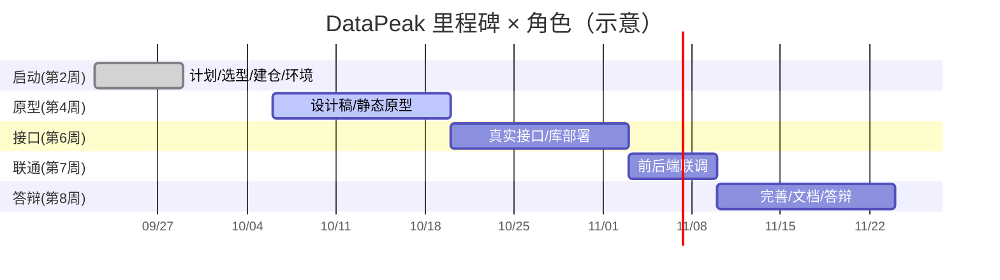

# DataPeak 电商销售数据洞察看板 · 角色分工文档

> **文档用途**：服务于课程答辩与团队流水线运作。明确 7 类角色的职责、产出物、里程碑与验收方式，并给出 **≤3 人小组**的角色映射建议。
> **编写**：产品经理·需求分析（许清楚 / Xu）　**日期**：2026-10-05
> **对应里程碑**：第 2 / 4 / 6 / 7 / 8 周末（课程周里程碑）。

---

## 0. 文档目的

本课程项目要求"按公司角色分工、以解决真实用户痛点为目标"。本文件把一次真实的软件团队流水线映射到本小组，使**每一份交付物都能落到具体角色、每一角色都有可验收的产出**，从而支撑答辩时"代码能讲清、文档能对应、分工有依据"。

> 角色体系（按项目截图角色表，已合并为 7 岗）：
> **项目经理 / 产品经理·需求分析 / UI·UX 设计师 / 前端开发 / 后端开发 / 测试工程师 / 运维·DevOps**

---

## 1. 角色总览

| 角色 | 一句话定位 | 关键交付物（摘要） |
|------|-----------|-------------------|
| 项目经理 | 定计划、控风险、统答辩 | 计划/里程碑、Git 仓库、进度审计、答辩 PPT |
| 产品经理·需求分析 | 找痛点、写 PRD、定优先级 | 需求文档、增量 PRD-v2、用户画像、需求池 |
| UI·UX 设计师 | 定规范、出视觉、改文案 | 设计规范、页面视觉稿、欢迎页、术语人话表 |
| 前端开发 | 原生 JS 实现 6 页面 + 联调 | dashboard 源码、图表组件、联调脚本 |
| 后端开发 | Spring Boot + JPA 接真实库 | backend 源码、schema + 导入脚本、Swagger |
| 测试工程师 | 接口/联通/回归验证 | 测试用例、测试报告、数据一致性核对 |
| 运维·DevOps | 环境/数据库/演示保障 | 启动脚本、库部署文档、环境清单 |

---

## 2. 逐角色详解

### 2.1 项目经理
- **职责**：制定项目计划与里程碑、跟踪进度与风险、跨角色协调、Git 仓库与提交规范、答辩统筹。
- **本项目产出物**：项目计划 / 里程碑表、`web项目/` 独立 Git 仓库（≥10 次带注释提交）、进度审计文档、答辩 PPT 与讲稿、《AI 使用记录表》汇总。
- **里程碑周**：第 2 周（定计划 / 建仓 / 选题）｜第 4 周（原型评审）｜第 6 周（接口验收）｜第 7 周（联调验收）｜第 8 周（答辩）。
- **验收方式**：里程碑按时达成；Git 提交 ≥10 次且注释清晰；答辩流畅；文档齐全。

### 2.2 产品经理 · 需求分析（许清楚 / Xu）
- **职责**：用户调研与画像、痛点挖掘、PRD 撰写、需求优先级（P0/P1/P2）、验收标准、竞品分析。
- **本项目产出物**：`需求文档.md`（基线）、`docs/增量PRD-v2.md`、目标用户画像（3 卡）、需求池、待确认清单、竞品差异化分析。
- **里程碑周**：第 2 周（需求基线）｜第 4 周（原型需求确认）｜第 6 周（接口需求对齐）｜第 7 周（联调需求验收）｜第 8 周（终稿）。
- **验收方式**：PRD 被架构师 / 开发采纳；需求覆盖率达标；答辩能讲清"解决什么用户痛点"。

### 2.3 UI · UX 设计师
- **职责**：信息架构、视觉规范（配色 / 字体 / 组件）、交互流程、欢迎页 / 门面设计、卖家语言文案。
- **本项目产出物**：设计规范（配色 / ECharts 主题）、页面线框 / 视觉稿、欢迎页设计、`术语 → 人话`映射表、原型评审记录。
- **里程碑周**：第 4 周（设计稿）｜第 6 周（规范定稿）｜第 7 周（联调视觉）｜第 8 周（打磨）。
- **验收方式**：6 页面视觉统一；设计规范可执行（开发人员照做）；欢迎页落地。

### 2.4 前端开发
- **职责**：原生 HTML/CSS/JS + ECharts 实现 6 页面，fetch 联调，诊断卡片 / 信号 / 预警 UI，欢迎页与主题。
- **本项目产出物**：`dashboard/index.html`（及 `welcome.html`）、图表组件、前后端联调脚本。
- **里程碑周**：第 4 周（静态原型）｜第 6 周（接口占位）｜第 7 周（真实联调）｜第 8 周（完善）。
- **验收方式**：F1–F8 + A1–A5 全部实现；图表交互流畅；CORS 联通；**未使用 Vue/React/axios**。

### 2.5 后端开发
- **职责**：Spring Boot 3.2 + JPA 分层（Controller/Service/Repository）、Entity/Repository、CSV→MySQL 导入、替换 Mock、新增 diagnosis/signals/alerts 接口、CORS/Swagger。
- **本项目产出物**：`backend` 源码、`database/schema.sql` + 导入脚本、真实查询实现、Swagger 文档。
- **里程碑周**：第 4 周（脚手架）｜第 6 周（真实接口 ≥2）｜第 7 周（全部联通）｜第 8 周（完善）。
- **验收方式**：数据真实（非 Mock）；接口规范；Swagger 可访问；分层清晰可讲解。

### 2.6 测试工程师
- **职责**：接口测试（curl/Postman）、前后端联通验证、数据一致性核对（看板数字 vs 库）、回归测试、缺陷记录。
- **本项目产出物**：测试用例、接口测试报告、数据一致性核对表、缺陷清单。
- **里程碑周**：第 6 周（接口测）｜第 7 周（联通测）｜第 8 周（回归）。
- **验收方式**：核心接口通过；看板数字与库一致；无阻断性 bug。

### 2.7 运维 · DevOps
- **职责**：环境搭建（Docker MySQL 8）、数据库部署、启动脚本、依赖管理、演示环境保障。
- **本项目产出物**：`docker-compose` / 启动脚本、数据库部署文档、环境清单。
- **里程碑周**：第 2 周（环境）｜第 4 周（本地可跑）｜第 6 周（库部署）｜第 8 周（演示环境）。
- **验收方式**：一键起库；答辩演示不宕机；环境可复现。

---

## 3. 里程碑 × 角色 矩阵

| 里程碑（周） | 项目经理 | 产品·需求 | UI·UX | 前端 | 后端 | 测试 | 运维 |
|-------------|---------|----------|-------|------|------|------|------|
| 第 2 周·启动 | 计划/建仓/选型 | 需求基线 | — | — | 脚手架 | — | 环境搭建 |
| 第 4 周·原型 | 原型评审 | 需求确认 | 设计稿 | 静态原型 | 接口骨架 | — | 本地可跑 |
| 第 6 周·接口 | 接口验收 | 需求对齐 | 规范定稿 | 接口占位 | **真实接口≥2** | 接口测试 | 库部署 |
| 第 7 周·联通 | 联调验收 | 需求验收 | 联调视觉 | **真实联调** | 全部联通 | 联通测试 | 环境保障 |
| 第 8 周·答辩 | 答辩统筹 | 文档终稿 | 视觉打磨 | 完善 | 完善 | 回归测试 | 演示环境 |

---

## 4. "3 人如何分饰 7 角" 角色映射建议

课程规定每组 ≤3 人。建议如下映射（按成员特长分配，可据实际微调）：

| 成员 | 兼任角色 | 理由 |
|------|---------|------|
| **同学 A（统筹型）** | 项目经理 + 产品经理·需求分析 | 定方向 / 计划 / 文档 / 答辩主讲，把控全局与需求基线 |
| **同学 B（设计 + 前端型）** | UI·UX 设计师 + 前端开发 | 设计稿与 6 页面 / 欢迎页 / 主题天然连续，效率高 |
| **同学 C（后端 + 质量型）** | 后端开发 + 测试工程师 + 运维·DevOps | 数据库 / 接口 / 部署 / 测试都围绕"环境与数据"，合并最自然 |

### 分饰原则
1. **测试尽量交叉**：A/B 做 UI / 需求走查，C 做接口 / 回归；关键缺陷集体评审。小团队无法完全独立测试，需在答辩中**书面说明**此现实。
2. **产品与项目由一人兼**，但 PRD 须经 B/C **评审签字**（答辩可展示评审记录），避免"自己写自己过"。
3. **运维与后端合并**最自然，但部署文档需 A 复核，避免"只有 C 会跑"。
4. **Git 提交**：每人按模块提交，项目经理统一规范与合并，保证 ≥10 次且注释有意义（如：①初始化脚手架 ②前端 KPI/趋势 ③前端表格分页 ④商品/用户/报表页 ⑤后端 pom/配置 ⑥Controller+DTO ⑦CORS/Swagger ⑧真实查询 ⑨schema+导入 ⑩README ⑪PPT）。

### 风险与对策
- **风险**：C 角色过重（后端 + 测试 + 运维）。**对策**：数据库导入脚本与 schema 可由 A 提前协助准备；测试用例由 A 设计、C 执行。
- **风险**：产品经理兼项目经理导致需求与计划混淆。**对策**：用本角色文档厘清边界，需求文档与计划文档分开归档。

---

## 5. 答辩怎么讲（本表使用提示）

- **一句话**：我们用公司真实流水线角色分工，3 人分饰 7 岗，每人都有明确产出与验收，保证"代码能讲清、文档能对应"。
- **强调红线对应**：数据库真实接入（非 Mock）→ 后端开发 + 运维；Git ≥10 提交 → 项目经理；AI 使用记录表 → 全员 + 项目经理汇总；文档齐全 → 各角色产出物已在表中列明。
- **展示建议**：答辩时投本表 + 里程碑甘特图，对应展示各角色交付物（PRD / 设计稿 / 源码 / 测试报告 / 启动脚本），形成"分工—产出—验收"闭环。
